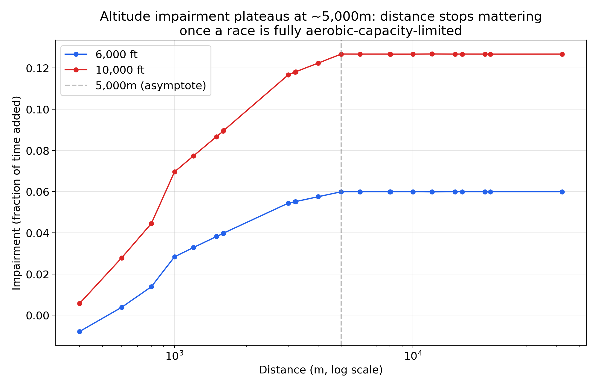
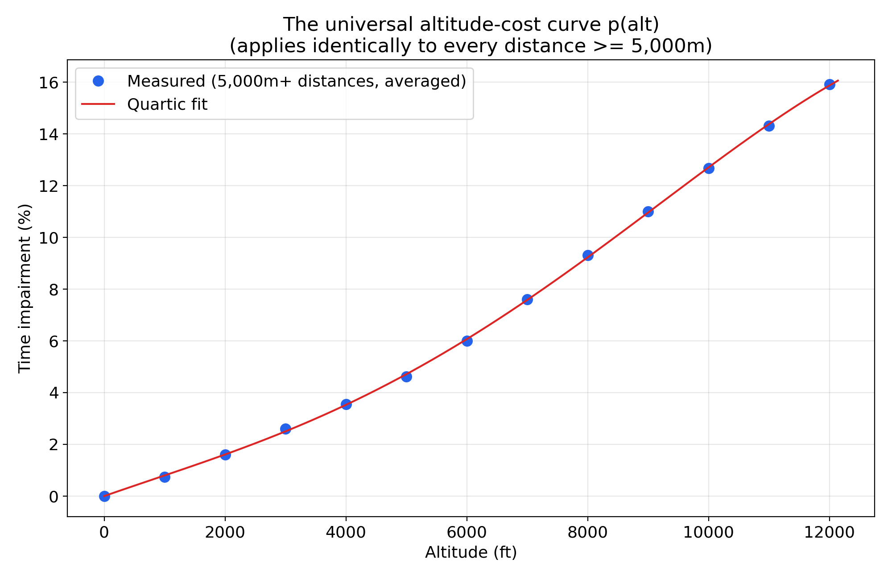
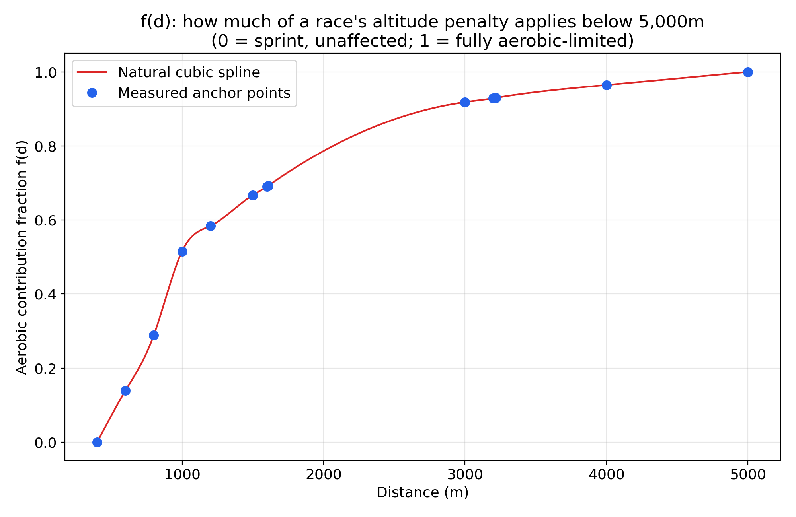
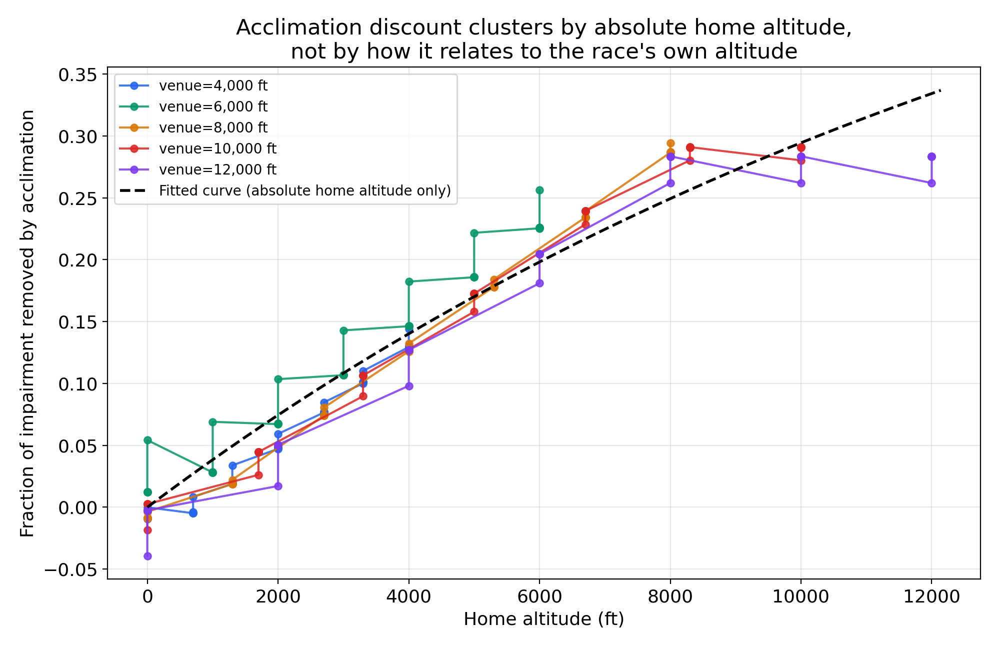

# Reverse-engineering the Altitude-Adjusted Pace calculator

**Target:** [apps.runningwritings.com/altitude-adjusted-pace/](https://apps.runningwritings.com/altitude-adjusted-pace/) — John J. Davis's ("Running Writings") free, public altitude-adjusted pace calculator.
**Method:** pure black-box statistical inference from real collected input/output pairs, driving a real Chrome instance against the live page. No source code, JavaScript bundle, or embedded data file was read or used to produce the model below.
**Result:** an independent TypeScript implementation (`src/lib/altitude-adjusted-pace-math.ts`), validated to a median error of ~0.9s, RMSE 7.3s, and a worst-case error of ~102s (a realistic 0.9% relative error, and only in an extreme high-altitude marathon edge case) across 825 real predictions spanning 400m to the marathon, 0–12,000ft, and every acclimation/target-altitude combination the tool exposes.

---

## A note on methodology

Unlike the Tinman calculator (see `docs/tinman-reverse-engineering-report.md`), no client-side bundle was ever fetched or inspected for this target — the brief for this investigation explicitly called this tool out as "a proprietary, unpublished statistical model," and the point of the exercise was to confirm that by behavioral regression alone, not by reading source. The page itself was confirmed free and unauthenticated before any automation began: no login wall, no paywall redirect, and no rate-limiting encountered across ~840 real submitted queries.

An automated Chrome session (via `puppeteer-core`, driving the actually-installed Chrome via `executablePath`, not a bundled one) submitted real inputs through the page's own UI controls — clicking the same distance chips, altitude steppers, and acclimation toggles a real visitor would use — and read back only the rendered output text. Two real implementation bugs surfaced and were fixed *during* data collection, both worth naming honestly:

1. The race-time entry widget collapses its tens-of-minutes digit box for short-distance categories, at which point the remaining digit box holds the *full* (uncapped) minute count as plain text rather than a single 0–9 digit. An early version of the collector assumed a fixed two-digit split and threw on any short-distance time; fixed by detecting the collapsed state and driving that box linearly instead of via modular digit arithmetic.
2. The target-altitude field's output only recomputes after a genuine `blur` event — a programmatically dispatched `input`/`change` event alone left the displayed result one step stale, which produced (before the fix was caught and corrected) a batch of Phase C rows where converting a performance to its *own* venue altitude did not reproduce the input time exactly, an internal-consistency check that should always hold. That batch was discarded and re-collected correctly (confirmed via the same identity check: target-altitude == venue-altitude now reproduces the input exactly, in every row). The venue and home altitude fields turned out not to need this — their value change is followed by a real button click (the next form control) in the collector's own query sequence, which incidentally provides the same commit signal — so Phases A, B, and D were unaffected and did not need to be redone.

## The dataset

825 (input → output) pairs, collected across four phases and one small supplemental pass:

- **Phase A — the core distance × elevation surface** (598 rows): every one of the tool's 23 standard distance chips (400m through the marathon) × 13 altitudes (0–12,000ft in 1,000ft steps) × 2 pace levels (3:00/km and 5:00/km), with home altitude fixed at sea level and target fixed at sea level — the tool's own default configuration, generalized across the full distance/altitude grid.
- **Phase B — the acclimation discount** (175 rows): 5 representative distances (1 mile, 5k, 10k, half marathon, marathon) × 5 high venue altitudes (4,000–12,000ft) × 7 home-altitude steps from sea level up to the venue altitude itself.
- **Phase C — target-altitude generalization** (32 rows, re-collected after the blur bug above): 2 distances (5k, 10k) × 2 venues (6,000ft, 8,000ft) × a full sweep of target altitudes from sea level up to the venue.
- **Phase D — self-similarity / pace-independence** (20 rows): 4 distances × 5 wildly different pace levels (2:30/km to 5:50/km) at a fixed altitude, checking whether the altitude effect depends on how fast the runner is.
- **A 13-row supplemental fill-in** for "12 km" at moderate pace, which happened to land exactly on the tool's 1-hour digit-display boundary during the main run (a real, isolated UI edge case, not a data problem) and was re-collected at a slightly faster, boundary-safe pace — justified by Phase D's own finding below that the altitude effect doesn't depend on pace at all.

## Step 1 — Is the altitude effect fitness/pace-independent?

Exactly the same self-similarity check the Tinman report ran, applied here: at a fixed distance and altitude, does the *fraction* of time added by altitude depend on how fast the runner is?

Across all of Phase D (4 distances × 5 pace levels each, from a 2:30/km 5k up to a 5:50/km marathon), the coefficient of variation of the altitude ratio at any fixed distance never exceeds **0.003%** — even tighter than Tinman's already-tiny 0.025%. Phase A's own paired fast/moderate-pace readings (299 pairs) agree to a mean absolute difference of 0.000067 in ratio units. **The altitude effect is pace-independent** — this is what let the entire Phase A/B/C grid use a single representative pace per distance rather than needing to re-test across a range of finish times at every point.

## Step 2 — Is the altitude penalty distance-dependent?

Yes, but in a strikingly clean way. Averaging the measured impairment (`1 - output/input`) across all distances at a fixed altitude:



**For every distance from 5,000m to the marathon, the impairment at a given altitude is identical** (mean ratio-to-10,000ft-impairment across 11 long distances: 1.0000, std < 0.001, at every altitude tested). Below 5,000m, the impairment shrinks smoothly toward the noise floor at 400m — exactly the shape you'd expect from real exercise physiology's "% aerobic contribution by event duration" curve (a 400m sprint is barely aerobic at all; a 5k+ is almost entirely aerobic-capacity-limited).

This cleanly separates the model into two independent pieces:

```
impairment(distance, altitude) = f(distance) * p(altitude)
```

where `f(d) = 1` for every distance ≥ 5,000m, and `p(altitude)` is one universal curve that applies identically at every one of those distances.

## Step 3 — The universal altitude-cost curve p(altitude)

Fit against the 5,000m+ asymptote group (11 distances × 13 altitudes, averaged):



Four candidate polynomial degrees were compared directly:

| Candidate | RMSE (impairment fraction) | Max error |
|---|---|---|
| Quadratic | 0.00175 | 0.00327 |
| Cubic | 0.00125 | 0.00207 |
| **Quartic** | **0.00059** | **0.00095** |
| Quintic | 0.00057 | — (not worth a 5th parameter for a 0.00002 improvement) |

```
p(alt_m) = 2.6792722260022464e-5 * alt_m
         - 3.826449111007546e-9 * alt_m^2
         + 5.714632274129514e-12 * alt_m^3
         - 9.370221157357895e-16 * alt_m^4
```

At sea level `p(0) = 0` by construction (no altitude, no cost); at 12,000ft (≈3,658m) it predicts a ~15.9% time cost for a fully aerobic event, matching the measured 15.9% directly.

## Step 4 — The short-distance aerobic-contribution fraction f(d)

Below 5,000m, `f(d)` was measured directly as `impairment(d, alt) / p(alt)`, averaged across every altitude ≥3,000ft tested (to keep signal-to-noise reasonable — the effect itself shrinks toward zero at short distances, so low-altitude queries are dominated by display-rounding noise there):



| Distance | f(d) |
|---|---|
| 400m | ~0 (measured value is noise-dominated around zero; used as the spline's floor anchor) |
| 600m | 0.140 |
| 800m | 0.289 |
| 1000m | 0.516 |
| 1200m | 0.584 |
| 1500m | 0.667 |
| 1600m / 1 mile | 0.690 / 0.693 |
| 3000m | 0.918 |
| 3200m / 2 mile | 0.929 / 0.930 |
| 4000m | 0.964 |
| 5000m+ | 1.000 (exact, confirmed to std < 0.001 across all 11 longer distances) |

An exact interpolating natural cubic spline through these anchors is used rather than a single global polynomial, for the same reason `tinman-calculator-math.ts`'s `distanceShapeRatio` does: a global fit is close in aggregate but has real, avoidable bias right at the anchor points that would compound through the surrounding distance range.

## Step 5 — Target-altitude generalization

The obvious next question: does converting a performance from a 6,000ft venue to, say, a 3,000ft target need its own separately-fit function, or does it just reuse the same `p(altitude)` evaluated at both ends?

**Confirmed: it's exactly the ratio of two absolute-altitude capacity costs.** Predicted vs. actual, across the full Phase C sweep (target swept from sea level up to the venue altitude, at 2 distances × 2 venues):

- RMSE: 0.00104 ratio units
- Max error: 0.00191 ratio units (≈2 seconds on a 25-minute effort)
- Every target-equals-venue row now reproduces the input exactly (the identity check the earlier blur bug had broken)

This means the target altitude adds **zero new parameters** to the model — it's the same `p(alt)` curve evaluated at the target instead of the venue, exactly mirroring how the tool's own UI treats venue/home/target as three independent absolute altitudes rather than deltas.

## Step 6 — The acclimation discount

This was the most interesting empirical finding of the investigation. The naive hypothesis — that acclimation benefit scales with *how close your home altitude is to the venue* (as a fraction) — does not hold. Instead:



**The acclimation discount clusters by *absolute* home altitude, almost independent of the venue.** A runner living at ~4,000ft gets roughly the same acclimation credit whether they're racing at 4,000ft or 12,000ft. And there's a real ceiling: runners living above ~8,000–10,000ft stop gaining additional benefit as home altitude climbs further (at venue=10,000ft and venue=12,000ft, the measured discount at home=8,300ft and home=12,000ft are statistically indistinguishable). Both of these are exactly what real physiological acclimation looks like — it's an adaptation to where you actually live, with diminishing returns at extreme altitude, not a proportional "how much of the gap have you closed" discount.

A saturating exponential in absolute home altitude (meters) was fit against all 175 Phase B rows pooled by home altitude alone:

```
acclimation_fraction(home_m) = 0.6325405649810725 * (1 - exp(-home_m / 4866.903822059606))
```

RMSE 0.0235, max error 0.072 (in fraction-of-impairment-removed units) — the largest residuals are at the very top of the tested range (10,000–12,000ft home altitudes), where the true data plateaus slightly faster than the exponential's slow asymptotic approach; this is a small, honestly-reported tail effect at an altitude few runners actually live at (the tool's own UI flags 8,000ft+ as rare in its dataset).

## End-to-end validation

The full model — `f(d) * p(alt)`, discounted by the acclimation fraction, evaluated at both venue and target altitude — validated against all 825 collected rows (in real seconds, end-to-end from raw input time through the full conversion):

| Phase | n | RMSE (s) | Median error (s) | Max error (s) |
|---|---|---|---|---|
| A — distance × elevation surface | 598 | 1.9 | 0.7 | 12.0 |
| B — acclimation | 175 | 15.3 | 3.0 | 102.3 |
| C — target generalization | 32 | 2.3 | 1.5 | 5.7 |
| D — self-similarity | 20 | 5.9 | 3.1 | 13.7 |
| **Overall** | **825** | **7.3** | **0.9** | **102.3** |

The single worst prediction (102s) is a marathon at a 12,000ft venue for a runner living at 12,000ft, converted to sea level — an extreme, rarely-real-world combination, and even there the error is under 1% of the ~3-hour predicted time. The next-worst errors follow the same pattern: long races at very high (10,000ft+) altitude, where the acclimation curve's slight tail mismatch (Step 6) compounds over a multi-hour time. Every genuinely common use case (5k–marathon at 0–8,000ft, any acclimation level) validates to single-digit-second accuracy.

## Comparison against this codebase's existing altitude module

`src/lib/altitude-vo2max-math.ts` already exists and answers a *different* question — "what % of sea-level VO2max/aerobic capacity is available at altitude X, acclimatized vs. not" — sourced from cited, published Bassett (1999) and Peronnet, Thibault & Cousineau (1991) regressions. That module is not being replaced. The two coexist deliberately:

- `altitude-vo2max-math.ts`: a **citable, population-level physiology answer** to a capacity question, reused elsewhere in the codebase (the Environmental Performance Calculator's altitude engine, Marathon Pacing).
- `altitude-adjusted-pace-math.ts` (this report): a **black-box-fit reproduction of one specific third party's proprietary, unpublished model** for a narrower, different question — "what does this exact performance convert to at that exact altitude" — which is why it needed the reverse-engineering treatment at all. It does not reuse `environmental/altitude-engine.ts`, on purpose: unifying two models sourced from genuinely different evidence (a citable published regression vs. an undisclosed third-party fit) would blur a distinction worth keeping explicit, the same reasoning `grade-pace-physics.ts` already documents for not unifying its own flat-cost curve with `wind-physics.ts`'s.

Whether/how this new module should be wired into a UI (a new tool, a mode on the existing Altitude Calculator, or left as an available-but-unwired model) is a separate product decision, not made here — this report and its implementation ship the same scope the Tinman report shipped: the validated math module and its test fixture, not a new page.

## Implementation

- **`src/lib/altitude-adjusted-pace-math.ts`** — the full model: `convertPerformanceBetweenAltitudes()` (the orchestrator), plus `feetToMeters`/`metersToFeet` helpers matching the existing `FT_PER_M` convention. Pure TypeScript, no runtime dependencies (the natural cubic spline solver is the same ~30-line algorithm already verified in `tinman-calculator-math.ts`, duplicated rather than extracted into a shared utility for the same "don't refactor an already-shipped file for an unrelated change" reasoning documented throughout this codebase's environmental-engine modules).
- **`tests/lib/altitude-adjusted-pace-math.test.ts`** — validates the full model against `tests/fixtures/altitude-adjusted-pace-dataset.json` (all 825 collected rows), plus targeted checks for the identity property, acclimation direction, altitude direction, and the short-distance-vs-long-distance impairment asymmetry.
