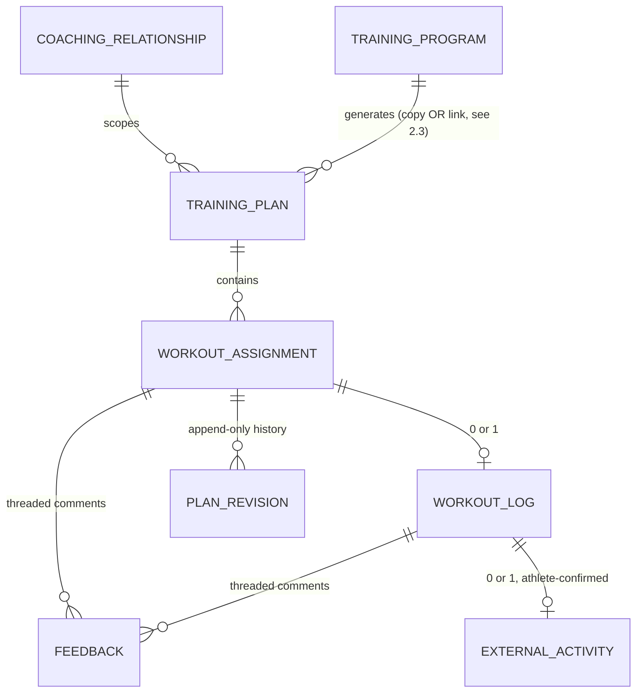
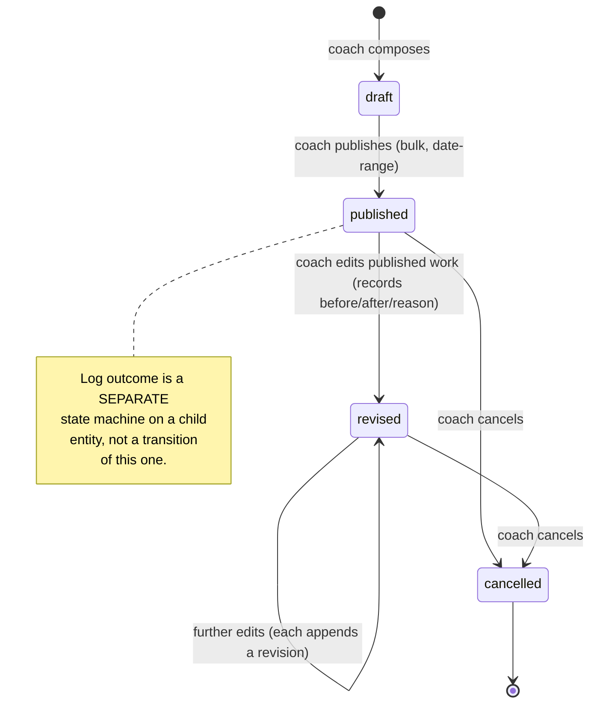
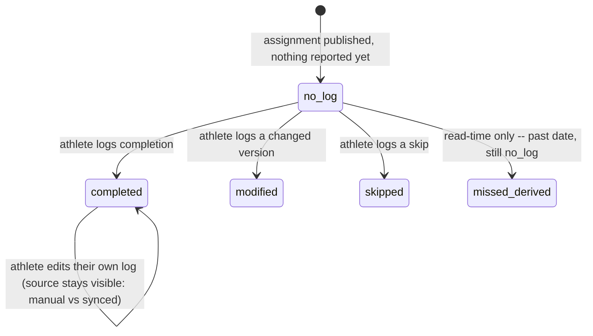

# 05 — Target Architecture

This document owns technical enforcement: the canonical prescription contract, assignment/log separation, state machines, transaction boundaries, authorship, append-only history, and migration approach. Product behavior (what a screen does) belongs to `04-target-product-experience.md`; this document exists to make that behavior actually true at the data layer, closing the gap `01-current-architecture.md` found between what the product claims (draft/publish, percent-of-pace targets) and what the code actually guarantees.

Every recommendation here traces to a numbered defect in `01-current-architecture.md` (cited as `D#`) or a finding in `02-competitive-research.md`.

---

## 1. The three reconciliations

### 1.1 Prescription — one canonical, lossless, discriminated contract

**The problem (D1, D2, and the root-cause analysis in `01` §4):** six mutually exclusive intensity/volume modes, duplicated across six tables, with 14 files each independently responsible for not forgetting one of them. The failure mode is not a crash — it's silent data loss, confirmed live in production data (`03-ux-audit.md` §2.1).

**The fix is not a new storage format.** The Reconciliation Memo is explicit that "typed JSON" is a premature *solution*, not the actual requirement — intervals.icu (`02` §4) proves percent-of-reference targets are sound as a *concept*; the defect is that Haarchive re-implements that one concept six separate times. The fix is a **single shared TypeScript discriminated union**, used everywhere a prescription is read or written, with the database shape following the contract rather than the contract being inferred from six divergent tables after the fact.

```ts
// The ONE prescription shape. Every table that stores a prescription
// (scheduled_workouts, workout_templates, program_days, and their
// respective *_steps children) stores exactly this shape -- not six
// independent column families that happen to overlap.
type IntensityTarget =
  | { mode: "distance"; minM: number; maxM: number | null }
  | { mode: "duration"; minS: number; maxS: number | null }
  | { mode: "volumePercent"; percent: number } // resolved against that week's training_week_plans target
  | { mode: "pace"; minSPerMi: number; maxSPerMi: number | null }
  | { mode: "paceReference"; reference: PaceReferenceKey } // resolved live from most recent race
  | { mode: "pacePercent"; basis: PaceReferenceKey; minPercent: number; maxPercent: number | null } // resolved live from athlete_fitness_estimates
  | { mode: "heartRate"; minBpm: number; maxBpm: number | null }
  | { mode: "rpe"; min: number; max: number | null }
  | { mode: "open" };
```

**This is a discriminated union, not six nullable column families.** A row either has *one* `IntensityTarget`, or (for a step that legitimately needs more than one simultaneous signal — Final Surge's pace+HR+power-together pattern, `02` §3) a small array of them, never an ambiguous combination of null/non-null columns a reader has to reverse-engineer. Persistence can still be relational (a `mode` enum column plus mode-specific nullable columns, matching today's shape) or a single `jsonb` column holding the serialized union — **that choice is deliberately deferred to implementation**, per the memo's own instruction, because it doesn't change the contract's correctness. What changes is that **exactly one function** serializes this type to a row and **exactly one function** deserializes a row back to this type, replacing the 6-times-reimplemented step mapping found in `01` §7.4. Every reader and writer in the product goes through those two functions. A new consumer that forgets a mode fails a type check at compile time, not silently at runtime three months later.

**Purpose stays first-class, not bolted on.** Per the design principle both the blueprint and the site's own content philosophy (`CLAUDE.md` §5: "why before what") independently arrive at: every prescription carries a `purpose: string | null` field adjacent to the `IntensityTarget`, not merged into free-text `instructions`. "Threshold intervals" tells a coach what; "raise sustainable speed" (the blueprint's own example) tells the athlete why. This is a one-column addition, not a redesign — `workout_templates`/`scheduled_workouts`/`program_days` already have `day_label`; `purpose` is a sibling, always shown adjacent to it on every surface that renders a workout.

**Structure is a tree, not a flat list — and the current model cannot express what a coach already writes.** Today `scheduled_workout_steps` is a flat ordered list (`step_order`) where repetition is an integer column on an individual step. That representation cannot hold a nested set. "2 sets of 6 × 500m with 30s rest, 3 min between sets" has to be flattened to `repetitions: 12`, discarding the set boundary and the between-set recovery, which are the two things that make it that workout rather than a different one. This is not hypothetical: it was hit directly while hand-authoring the Canyon program's structured days during this engagement, and resolved by flattening with a note, because the schema offered no alternative.

Both structured-workout implementations examined in `02-competitive-research.md` model this as a tree instead. TrainingPeaks' Structured Workout Builder treats a repeat as a first-class container: a coach drags blocks into a repeat, sets the count with `+`/`-`, and editing one interval inside a multi-step repeat propagates to every corresponding interval in that block, which is only possible if the repeat owns its children. intervals.icu's text syntax expresses the same thing with explicit parentheses (`3x(5m 100%, 2m 55%)`). Neither treats repetition as a scalar attached to a leaf.

The recommendation follows: a workout's steps form a shallow tree, where a node is either a leaf carrying an `IntensityTarget` or a repeat container carrying a count, its own recovery between iterations, and an ordered list of child leaves. One level of nesting covers every workout this site's own content library actually prescribes (`workout-library`, `marathon-training`, `5k-training`); arbitrary depth is not required and should not be built. This is a change to the **step** model, not to `IntensityTarget` itself, which stays exactly as above and is carried by leaves. It belongs in Stage 0 alongside the contract work rather than later, because retrofitting nesting after the serialize/deserialize pair is written against a flat list means rewriting that pair a second time.

**A relative target must freeze its resolved value when it is published, and keep the relative expression alongside it.** This is a new requirement, added on the strength of `02` §7's second market gap, and it is the one place this audit found where the product could be better than anything surveyed rather than merely as good.

The problem is a direct consequence of §1.1's own design. A `pacePercent` target resolves live against `athlete_fitness_estimates`. That is correct while the workout is a draft, and it is what makes a library workout apply sensibly across athletes. But once a workout has been **published**, the athlete has read a specific number and gone and run it. If their fitness estimate moves from a 19:30 5K to a 18:55 in week 5, every already-published week-3 workout silently re-resolves to a pace the coach never prescribed and the athlete never saw. Every historical record of what was asked for is rewritten by a single settings change, retroactively and invisibly. That is the same silent-data-loss failure class as D1, arriving by a different route, and this audit did not catch it in the code pass because it is a design consequence rather than a bug in any one file.

**The rule:** publishing an assignment writes the *resolved* absolute values (the actual pace band, the actual heart-rate range) onto the published row, alongside the unchanged relative expression that produced them, plus a reference to the fitness-estimate row they were resolved against. Reads of published work use the frozen values. The relative expression is re-resolved only when a coach explicitly republishes, which is a material revision and therefore already produces a revision record under invariant 5. Coachbox is the nearest precedent, tracking zone history with automatic recalculation; no surveyed product freezes resolved values into the published snapshot, and V.O2's publish log — the most developed in the market — does not capture them either.

**Why this matters beyond correctness:** "what did I actually ask for, in absolute numbers, on the day they ran it" is the load-bearing question for a coach adjusting from an athlete's RPE and pain reports. A platform that cannot answer it cannot support the review step in `04`'s coach path. This also implies `athlete_fitness_estimates` rows should be append-only rather than updated in place, so a frozen reference always resolves to something that still exists.

### 1.2 Publication — saved, published, revised as real, distinct states

**The problem (D1's second half, D6, D8, D9):** `published_at` is the only state signal, set by exactly one function operating on one workout at a time, with no bulk path; closing a modal can silently save; draft-state tables leak to athletes; nothing is ever revalidated on the pages that most need it.

**Contract, stated as invariants (these become the round-trip and mutation-semantics tests in `07-testing-strategy.md`):**

1. **A save is never implicit.** No navigation, dismissal, or backdrop interaction writes data. Every write is triggered by an explicit, labeled action the user chose (D6's fix).
2. **Draft and published are visibly different states everywhere**, not just gated by a null timestamp checked inconsistently. Every table holding coach-authored content an athlete might see (`scheduled_workouts` and *all* of its siblings — `training_phases`, `training_week_plans`, not just workouts) gates athlete visibility on the same publish signal (fixes D9).
3. **Publishing has a real unit larger than one row.** This is the invariant that matters most structurally, and it is the one the competitive research most directly informs. There is currently no bulk-publish action at all, which is *precisely why* every program-assigned workout must pass through the single-workout editor that drops fields (D1). Any mechanism that stops routing newly-generated content through that editor closes D1's structural cause; the editor is fixed in parallel (§2 below) so it is safe either way.

   **Revised recommendation, on the completed competitive research (`02` §2, Hypothesis 1).** This section's recommendation changed twice as evidence accumulated, and the intermediate position is recorded here rather than quietly deleted, because the reasoning that made it wrong is instructive.

   The market splits into three camps. **Camp A**, a rolling visibility horizon (Nolio's 100-day default, Final Surge's *N* days or hard date). **Camp B**, per-workout Hide framed as a long-term-planning exception (TrainingPeaks). **Camp C**, hidden-by-default with publishing as a first-class, logged, reversible **event** — V.O2 alone, arrived at over eight years of iteration.

   An intermediate draft of this section recommended Camp A, on the reasoning that a horizon makes visibility a *derived* property (compare the date against the relationship's horizon) rather than per-row state that one of fourteen writers can forget to set. That reasoning about derived predicates is still correct. **The recommendation built on it was not**, for a reason the fuller research made obvious: a horizon controls how far *ahead* an athlete sees, and cannot make **next Tuesday** private. Shortening the window far enough to hide the week being reworked also destroys the athlete's ability to plan their life, which is the window's entire purpose. Nolio's own documentation confirms the consequence — a session appears in the athlete's calendar the moment it is created, so the coach composes in public. A horizon is a scheduling convenience, not a draft state, and the two are not substitutes.

   **Therefore: Camp C.** Workouts are **hidden by default**. Publishing is an explicit **event** recorded in its own table: which assignments were released, by whom, when, grouped as one batch, reversible by unpublishing that batch. A visibility horizon may sit on top as a convenience, but it is not the mechanism.

   **This resolves the derived-predicate concern too, which is why Camp C is not a step backwards from Camp A.** Hidden-by-default is a *safe* default: a writer that sets nothing produces a hidden workout, and the failure mode is an athlete not seeing work that exists, which is recoverable and visible to the coach. The current model fails the other way. More importantly, **D1's real cause is not that publishing is per-workout — it is that the publish path re-writes the workout row and drops columns while doing so.** A publish that only inserts an event row and flips a visibility flag touches no prescription field at all, and therefore *cannot* drop one. That is a stronger guarantee than bulk-publishing a date range through the same lossy writer would have given.

   **Skip the auto-publish scheduler.** V.O2 ships cron-scheduled release and documents its own footguns: publish time in the coach's timezone, and gaps when the visibility window is shorter than the publish period. For one coach with a handful of athletes, "publish this week" is one click and automation buys nothing. But **build the publish event as a real table from day one** — V.O2 shipped the boolean in 2018 and the log in 2026, and retrofitting a log onto a boolean is the expensive version of this. `04-target-product-experience.md` §2.4 is revised to match.

   **Notifications become simple again under this model**, which is the incidental benefit. A publish is a discrete, timestamped act with a known batch of contents, so "your coach published next week" fires once, on a real event, with an accurate payload. That was the hardest problem with the horizon model and it disappears here.

4. **Coach intent, once an athlete has acted on it, is not freely retractable.** New, from the research: TrainingPeaks enforces that *once an athlete uploads data to a workout, the coach can no longer hide it*, and ships a separate **Lock** state whose documented purpose is preventing athletes from editing planned values after completing them to make compliance look better than it was. Both are integrity rules this audit had not considered, and both are cheap here. The first follows automatically from §2.3's assignment/log split (a log row exists, so the assignment cannot be made invisible). The second is a direct argument for the same split: if planned and actual live in different rows, an athlete editing their log physically cannot rewrite what was prescribed, and no "lock" feature is needed to prevent it. Note this as an independent, market-validated confirmation of §2.3 rather than a new requirement.
5. **A material edit to already-published work creates a revision, not a silent overwrite.** "Material" is scoped narrowly and explicitly (see `09-evidence-and-open-questions.md` for the exact threshold to set — date, distance/duration/pace target, or purpose changing; day-label or coach-note wording changing is not material) so this doesn't become friction for every trivial edit. A revision record holds `before`, `after`, `reason` (coach-supplied, short), `author`, `timestamp`. Revisions are **append-only** — no revision row is ever updated or deleted, matching `workout_comments`' own existing immutability convention (`01` §, `workout_comments` has no UPDATE policy today) extended to prescriptions.
6. **The athlete's own log is never overwritten by a coach's edit.** A revised assignment and a submitted log are different rows with a foreign-key relationship, never the same row (this is what closes the loop cleanly — see §1.3).
7. **Every mutation revalidates every surface that displays its effect**, closing D8. Concretely: publishing/revising a workout revalidates the schedule view, the workout detail page, `/coaching` (both roles' home), and the athlete-detail page — not just the schedule route, as today.

### 1.3 Product boundary — `/coaching` and `/coach` stay separate; here is the shared surface

`01` §11 established the two products share almost nothing today: different session flags, different prescription tables, different completion tables, no shared components. The Reconciliation Memo asks this audit to state the relationship explicitly rather than leave it implicit.

**Recommendation: keep them architecturally separate, but converge on one prescription contract going forward.** Full unification (one schema, one route tree, a role-aware surface) is rejected for this stage — it's a significantly larger migration than anything else in this document, `/coach` was explicitly out of scope for this audit's depth (per the approved plan), and nothing in the evidence gathered suggests the team-coaching product shares the private-coaching product's actual pain points (the six-mode prescription defect is specific to `/coaching`'s own accreted schema; `/coach`'s `workouts`/`group_plan_workouts` tables were not audited and may or may not have the same problem). Forcing them into one data model now, without having audited whether `/coach` even wants percent-of-pace targets or revision history, would be exactly the kind of premature architecture this document's own principles argue against.

**What does converge:** the `IntensityTarget` contract from §1.1 is designed to be adoptable by `/coach`'s own workout tables later without forcing a rewrite of this document's recommendations — it's a plain TypeScript type with no private-coaching-specific dependency. If `/coach` is ever redesigned, it should import this contract rather than invent a seventh implementation. That is the extent of the convergence this audit recommends now: a shared *vocabulary*, not a shared *schema or route tree*. Navigation-level confusion (a coach who does both team and private coaching sees two unrelated "coaching" experiences) is named here as a real, open product question for `09-evidence-and-open-questions.md`, not resolved in this pass.

---

## 2. Domain model

Adopting the blueprint's entity separation where the current schema conflates concepts, and explicitly reconciling it against what already exists and works (the memo's "existing-system reality" framing).



### 2.1 Tension: does a `training_plan` container need to exist?

**Blueprint recommendation:** yes — a `training_plan` sits between the coaching relationship and individual workouts, holding lifecycle (`draft/active/completed/archived`) and a goal reference.

**Current reality:** no such container exists. `scheduled_workouts` hang directly off `(athlete_id, coach_id)`; `training_phases` is a loose, date-ranged overlay with no containment relationship to the workouts inside its dates — a workout's membership in a phase is *computed* from date overlap, not stored.

**Resolution: adopt a real container, but make it `training_phases` extended, not a new parallel entity.** `training_phases` already has almost everything `training_plan` asks for — `athlete_id`, `coach_id`, `start_date`, `end_date`, a free-text `phase_type`, provenance columns pointing back to the Program it was generated from (`source_program_id` etc., added `20260925030000`), and a real exclusion constraint preventing date overlap per athlete. What it's missing is an explicit **status** (`draft/active/completed/archived`) and a **goal reference** (`goal_id` already exists on `training_phases` — confirmed in `01`'s schema notes — so this is already partially done). Adding a `status` column and making `workout_assignment.plan_id` a real foreign key to `training_phases.id` (rather than the current implicit date-overlap relationship) closes this gap without introducing a redundant second container concept. This directly enables invariant §1.2.2/§1.2.3: a phase's status gates its own workouts' visibility as a single toggle, replacing the current one-row-at-a-time publish.

### 2.2 Tension: `external_activity` as its own entity vs. the existing flat `completed_workouts.strava_activity_id`

**Blueprint recommendation:** a separate `external_activity` entity (`provider`, `external_id`, `summary_json`, `matched_log_id`), reversible matching.

**Current reality:** `completed_workouts.strava_activity_id` is a flat nullable column — null means manual entry, set means Strava-derived. The Aug 2026 calendar audit (`docs/private-coaching/coaching-calendar-audit.md` §2) explicitly recommended *keeping* this flat shape, arguing the more-normalized split "is not obviously wrong and a migration to split it should not be assumed necessary."

**Resolution: split it, but only because the review layer now needs to, not because normalization is inherently better.** The deciding factor is `strava_pending_matches` (`01`'s schema notes): this table *already* exists as a de facto `external_activity`-shaped entity — it holds `provider`-equivalent context (currently Strava-only, but structurally provider-agnostic), summary metrics, and a `dismissed_at` reversibility flag, entirely separate from `completed_workouts`. The current design just never promotes a pending match into a first-class `external_activity` row on approval — it deletes the candidate rows and stamps `completed_workouts.strava_activity_id` directly (`01`, `completion-actions.ts:232`). **Recommendation:** formalize `strava_pending_matches` as the pre-confirmation staging table it already functionally is, and on approval, write a real `external_activity` row (provider, external ID, summary, `matched_log_id`) rather than collapsing straight into a column. This costs one new table and one changed write path, reuses a policy shape (`strava_pending_matches`' existing athlete-only RLS) that already works, and directly enables "athlete can correct a match" (blueprint Stage 3) without re-deriving matching from scratch. The Aug audit's caution about premature normalization is respected — this isn't normalization for its own sake, it's promoting a table that already does the job into the role it already plays.

### 2.3 Tension: assignment status vs. log outcome — the direct cause of D4

**Blueprint recommendation:** assignment status (coach intent: `draft → published → completed/cancelled`) and log outcome (athlete execution: `completed/modified/skipped`) are two separate fields on two separate entities, never collapsed.

**Current reality:** `scheduled_workouts.status` tries to be both at once (`scheduled/completed/missed/skipped`), written by three unchecked service-role calls, while the UI independently derives its own notion of status and mostly ignores the column. This is exactly why `missed`/`skipped` are unreachable — nothing distinguishes "the coach never intended anything to happen here" from "the athlete didn't do what was asked."

**Resolution:** split cleanly, matching the blueprint exactly, because the current collapsed model is the direct, demonstrated cause of D4:

- `workout_assignment.status`: `draft | published | revised | cancelled` — coach-authored, changes only when the coach acts.
- `workout_log.outcome`: `completed | modified | skipped` — athlete-authored, exists only when the athlete has actually logged something (the blueprint's `0 or 1` relationship: an assignment with no log is simply "not yet reported," which is a real, valid, common state — most of a training week at any given moment).
- **"Missed" becomes a derived, read-time fact** (published, in the past, no log exists) rather than a stored enum value — which is what `computeWorkoutStatus()` already effectively does today (`01` §5.4); this change makes that the *only* source of truth instead of a second, disagreeing one.

## 3. State machines





`missed_derived` is not a stored state — it's what a reader computes when `no_log` persists past the assignment's own date. No write ever produces it, closing the exact gap D4 documents.

## 4. Transaction boundaries and mutation contracts

Every multi-row write identified as unguarded in `01` §5.3/§5.5 gets an explicit contract. Pattern, stated once (Postgres/Supabase, matching `assign_program_generation`'s own existing correct precedent — `01` §3, the one function in the current codebase that already does this right):

> **Every operation that writes a parent row plus its children (steps, extras, or a revision) does so inside a single database transaction** — either a Postgres function (`security definer`, matching the existing `assign_program_generation` pattern) or an explicit multi-statement transaction from the server action, never a bare loop of independent PostgREST calls. On any failure, the entire operation rolls back; the caller sees one clear error, never a partially-written parent.

Applies directly to: saving a workout's steps/extras (replaces the delete-then-reinsert pattern in D5), publishing a date range (§1.2.3 — this is inherently multi-row and must be one transaction, not a loop with per-row error swallowing like today's `copyWeek`), creating a revision (the revision write and the assignment update happen together or not at all), and phase reordering (fixes D7 — a single transaction reassigning all positions atomically, rather than one `UPDATE` per row against a live unique constraint).

**Idempotency:** publish and revise actions accept an idempotency key (or rely on the transaction's own natural conflict behavior) so a double-click or a retried request cannot double-publish or double-revise. This is new discipline, not present anywhere in the current codebase, and is cheap to add given the transaction boundary above already exists.

## 5. Authorization

No change to the fundamental model — `coaches_this_athlete()`-style RLS, scoped by an active relationship, is sound and already the established pattern (`01`'s schema notes: every private-coaching table since the first migration follows it). Two concrete additions the current schema is missing:

- **Ended relationships must be explicitly checked, not just implicitly excluded.** `coaches_this_athlete()` should be verified to actually exclude `status = 'ended'` relationships from every write path, not just read paths — this needs a direct test (added to `07`), since it wasn't independently re-verified in this audit beyond confirming the function exists.
- **Revision authorship is always attributable.** Every `plan_revision` row records a real `author_user_id`, never a service-role write with no human attached — this is a natural consequence of implementing §1.2's revision contract correctly, called out here because today's status-flipping writes (`completion-actions.ts`) are service-role calls with no equivalent authorship trail.

## 6. Migration approach

Per the confirmed constraint (pre-launch, staging holds only test data — see the approved plan): **this is a re-seed, not a data migration.** No production data exists to preserve; no backwards-compatibility shim is warranted. Concretely:

1. Land the new schema (the `IntensityTarget`-shaped step/prescription tables, the `training_phases` status column, the `external_activity` split, the `workout_log`/`workout_assignment` status split) as fresh migrations, following this repo's own established pattern (additive-then-drop, matching how `scheduled_workout_extras` replaced the old `extras text[]` column in `20260826090000`).
2. Re-seed the Canyon program and any other test fixtures against the new schema using updated seed scripts — the existing `scripts/seed-canyon-program.ts` pattern already establishes how to do this safely and idempotently.
3. Delete the old test data on staging (already-established precedent — this session already did exactly this once, clearing 126 `scheduled_workouts` test rows on request).
4. **Do not apply any of this to production** until the target architecture is implemented and re-audited — production currently has zero coaching tables (`01` §1 constraints), so there is no urgency pressure pushing toward a partial or compatibility-preserving rollout.

This is explicitly the cheap path the "pre-launch, test data only" constraint buys — the roadmap in `08-implementation-roadmap.md` should not spend any effort on migration safety machinery this constraint makes unnecessary.
