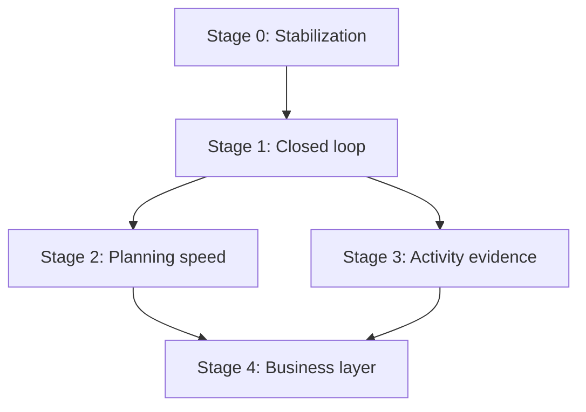

# 08 — Implementation Roadmap

This document owns sequencing. It adopts the blueprint's four-stage structure directly — nothing in the audit contradicts it, and the memo explicitly directs this document to sequence trust and the vertical slice before planning speed, Strava evidence, analytics, or billing. What changes from the blueprint is that each stage now names the *specific* defects from `01`/`03` it closes, rather than describing the stage in the abstract.

**Release gate, stated once and binding for every stage below:** do not begin the next stage until a real coach and a real athlete can complete the full north-star loop for one week without a manual database fix. This was already true once, informally, in this engagement — the Canyon program's own assignment pipeline needed a manual fix (the RPC payload gap) discovered only by directly inspecting the data after assignment, not by any automated signal. Stage 0 exists specifically so that stops being how these problems are found.

---

## Stage 0 — Stabilization and correctness

**Not in the blueprint's four stages; added here because `01`/`03` found active data-loss defects, not just missing features.** Nothing in Stage 1 should be built on top of a prescription model that silently drops data — fixing that first is cheaper than building Stage 1's UI against a foundation that needs to change underneath it immediately after.

**Progress note:** every concrete, verified data-loss instance of D1/D2 is fixed and regression-tested — see `01` §5.1/§5.2. This covers: the three writers' delete-then-reinsert step queries (`target_pace_percent_basis/min/max`, `repetitions_max`, `rest_max_s`); the day-level `pace_percent_basis/min/max` gap on `scheduled_workouts` (both the missing write path and the missing UI, `WorkoutForm` now has the same `allowPacePercent` mode `ProgramDayForm` already did); and two further instances found while fixing the above, in `duplicateScheduledWorkout` and `copyWeek`, which independently had the identical omission. None of this is the `IntensityTarget` contract below, which remains unbuilt; the contract is still the right next step, since it's what makes this whole class of bug structurally impossible rather than fixed instance-by-instance as each one is found — five instances of the same defect across five functions this session is itself the argument for building it. Bulk-publish is the one item from the original finding still fully open, tracked below.

**Second progress note:** the `IntensityTarget` contract itself (`05` §1.1) is now landed for the step level. `src/lib/private-coaching/intensity-target.ts` is the single shared discriminated union (all 9 modes from `05`'s own spec) plus its serialize/deserialize pair (`stepInputToIntensityTargets`, `intensityTargetsToStepFields`, and the DB-row variants `intensityTargetsToStepRow`/`intensityTargetsToTemplateStepRow` for the two step-table shapes). `saveScheduledWorkout`, `saveProgramDay`, and `saveTemplate` — the same three writers fixed earlier this session — now build their step-insert rows by calling this shared pair instead of hand-listing each column, closing the actual duplication D1/D2 were a symptom of, not just its previously-found instances. 12 new round-trip tests (`tests/lib/private-coaching/intensity-target.test.ts`) cover every mode plus the multi-signal (distance + pace-percent) case and a discovered self-healing property (a malformed row with a stale `targetType` alongside a set percent-basis normalizes to `targetType: "pace"` on the way back out, matching the DB's own `..._pace_percent_type_valid` constraint). Verified as a real integration, not just a compiling one: a deliberately introduced regression in the shared function's `pacePercent` case was caught by both the new unit tests and the existing `tests/app/private-coaching-step-fields.test.ts` server-action tests, then reverted.

**Still not done, and still the reason this item stays on the board:** the day-level contract (`scheduled_workouts`/`workout_templates`/`program_days`' own `planned_*`/`pace_*` columns), the read side (a reader reconstructing `IntensityTarget[]` from a DB row and rendering it — `calendar-data.ts`, the workout detail page, `summarizeStep` — still each hand-roll their own version), and the one-level step tree below.

| Item | Closes | Complexity | Depends on |
|---|---|---|---|
| Extend the `IntensityTarget` contract to the day level (`scheduled_workouts`/`workout_templates`/`program_days`) and to the read side (a shared `IntensityTarget[]` → row deserializer used by every reader, replacing each one's own hand-rolled reconstruction) | The remaining half of the 6× duplication — the step-level write side is now closed (see progress note above) | M | Step-level contract (done) |
| Make the step model a one-level tree (repeat containers own their children) rather than a flat list with a scalar `repetitions` (`05` §1.1) | The nested-set representation gap hit while authoring Canyon | M | Same work as the contract — do them together, not sequentially |
| Transactional writes for every steps/extras mutation (`05` §4) | D5 | M | `IntensityTarget` contract |
| Split `workout_assignment.status` from `workout_log.outcome` (`05` §2.3) | D4 | M | `IntensityTarget` contract |
| Fix `reorderPhaseDefinitions` atomicity | D7 | S | Transactional writes |
| Add the missing revalidation calls (`/coaching`, athlete detail) | D8 | S | — |
| Gate `training_phases`/`training_week_plans` athlete visibility on publish state | D9 | S | — |
| One real `layout.tsx` for the coaching tree, replacing the 12-file copy-pasted gate | D14 | S | — |
| `handle_new_user()` deterministic invite matching (`order by created_at` before `limit 1`) | The nondeterministic-trigger bug, `01` §10 | S | — |

**Acceptance:** the prescription round-trip invariant (`07` §2) passes for every mode, on every entity type, before Stage 1 begins.

**Risk:** this is schema-changing work touching the tables every other stage depends on. Mitigated entirely by the confirmed pre-launch constraint (`05` §6) — staging holds only test data, so this is a re-seed, not a migration with a rollback plan to design.

## Stage 1 — Closed loop

**One coach, one athlete, one week.** Directly the blueprint's Stage 1, using Stage 0's corrected foundation.

| Item | Closes / implements | Complexity |
|---|---|---|
| Consolidated week composer (one calendar surface, not four independently-fetching sections) | `01` §2's 901-line `schedule/page.tsx` problem | L |
| Explicit, no-backdrop-save workout editor | D6 | M |
| Hidden-by-default composition; publish as a logged, reversible event with its own table; one notification per publish (`05` §1.2.3) | D1's structural cause, `04` §2.4 | M |
| Freeze resolved absolute target values onto published rows, keeping the relative expression (`05` §1.1) | The silent retroactive-rewrite risk when a fitness estimate changes | S |
| Revision record on material edits, with reason | `05` §1.2.4 | M |
| Athlete History view | D3 — the single largest missing athlete-facing surface | M |
| Needs-review list (`04` §2.5) — moved up from Stage 2 | The blueprint's own Stage 1 criterion that a coach can find logs and exceptions quickly | S |
| Fixed Today card (accurate empty state) | The live-reproduced "no upcoming workouts" defect, `03` §2.1 | S |
| Mobile week agenda (replaces the horizontally-clipped grid) | D12 | M |
| Full-viewport mobile modal, matching the site's existing convention | The mobile modal defect, `03` §1.2 | S |
| Apply the mocked-Supabase harness to the completion/status actions (`07` §3.1) | D11 (partial — the highest-priority slice) | M |

**Acceptance (the blueprint's own Stage 1 test, adopted verbatim, each item now traceable to a fix above):** a coach can invite an athlete and cannot see their data before acceptance; a coach can draft seven days without exposing partial work; publishing makes the week visible with one notification; each workout displays purpose, instructions, and structured targets; an athlete can log completed/modified/skipped in under a minute; a coach can find new logs and pain/effort exceptions quickly; feedback stays attached to the workout; a published edit preserves the old value and records the reason.

**This is the release gate.** Per both the blueprint and this document's own opening statement: nothing below begins until this stage's acceptance criteria hold for a real week, not a synthetic test.

## Stage 2 — Planning speed

Make repetition cheap, once the loop underneath it is trustworthy. Duplicate week, reusable workout library reachable directly from the calendar (closing the "13+ entry points, no one-click template apply" finding, `01` §7.2), and availability notes.

**Moved up into Stage 1 by the completed research:** the review surface. `04` §2.5 now recommends a single reverse-chronological needs-review list rather than a roster dashboard, which is one query and one list rather than a screen worth deferring. It also belongs in Stage 1 on its own merits, since the blueprint's own Stage 1 acceptance criteria already require that "a coach can find new logs and pain/effort exceptions quickly" — that criterion was previously satisfied only by a roster signal that was itself deferred.

**Still deferred to Stage 2, and only if real use justifies it:** roster-wide dashboards, subscribe-to-events notification preferences (Nolio's model, cheap but unnecessary at one athlete), and anything resembling automated flagging beyond the explicit rules in `04` §2.5.

**Depends on:** Stage 1's revision mechanism (a "revision reason" UI is listed in the blueprint's own Stage 2, and only makes sense once revisions exist at all).

## Stage 3 — Activity evidence

Match Strava activities to assignments, preserve the raw identifier and summary via the `external_activity` split (`05` §2.2), show match confidence, let athletes correct a match. This also closes D10's second half: fixing the Strava sync button's misleading success copy and its missing revalidation of `/coaching`, and giving `/dashboard` genuine coaching awareness (or, more precisely per the boundary decision in `05` §1.3, giving `/coaching` its own Strava entry point rather than routing coached athletes through a screen built for a different product).

**Depends on:** the `external_activity` entity existing (Stage 0/1 schema work) and a real athlete population large enough that manual-only entry is actually the bottleneck it's designed to relieve — not urgent before Stage 1 proves the manual path works.

## Stage 4 — Business layer

Onboarding, package status, billing, consent records, exports, operating metrics — exactly as the blueprint specifies, with payment state kept strictly separate from plan state (the blueprint's own explicit rule, and consistent with this product's current, deliberate choice to ship free with no billing infrastructure at all, per `docs/private-coaching/prd.md` §6). Nothing in this audit found a reason to reconsider that sequencing; if anything, `02-competitive-research.md`'s finding that TrainingPeaks' per-athlete pricing is the market's most consistently criticized aspect argues for taking real time on this stage's design rather than rushing it once Stage 3 lands.

**One item deserves reconsideration for earlier delivery, though: athlete data export.** `02` §1 found that coaches in this market have been burned twice in two years by acquisition-then-shutdown (Today's Plan taking Stages' training log with it in 2024, RGT in 2023), with the result that data portability is a live trust question rather than a compliance checkbox. It is filed here with the rest of the business layer, which is defensible for a product with no external customers yet. But it is cheap, it is a genuine differentiator against a consolidating market, and an athlete asking "what happens to my training history" is a question this product will face on its first real athlete, not at Stage 4. Flagged for Brody's judgment rather than moved unilaterally.

## Explicitly deferred, matching the blueprint's own list

Payments/subscriptions, marketplace discovery, group teams/clubs (already exists as the separate `/coach` product — `05` §1.3's boundary decision means this is a *non-goal*, not a deferred item, for the private-coaching product specifically), in-app real-time chat (the existing 15s/45s polling is a deliberate, documented, zero-incremental-cost choice per `prd.md` §6 and nothing in this audit found reason to revisit it before real usage volume demands it), adaptive/AI plan generation.

## Sequencing dependencies, stated explicitly

Stage 2 and Stage 3 are not strictly ordered relative to each other — both depend only on Stage 1's foundation, not on each other. A team could parallelize them once Stage 1's gate is cleared, if capacity allows; this document does not mandate strict serialization there, only that neither starts before Stage 1's acceptance criteria hold.
